# CodeRoyale
Multiplayer coding quiz for learning practical programming.

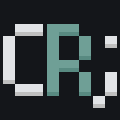

**Created by Zack Brokaw, Rahul Das, Bryan Faryadi, Michael Kopczynski, and Daniel Willett**

Fall 2026 - ITCS 6112 091 - Dr. A. Sever (UNC Charlotte)

* Source code available at [https://github.com/ITCS-6112-CodeRoyale/CodeRoyale](https://github.com/ITCS-6112-CodeRoyale/CodeRoyale).  
* The demo site can be accessed through [https://coderoyale.uncreated.network](https://coderoyale.uncreated.network) (this is hosted on one of our team members’ server box, which explains the random domain name).

# Installation and Deployment

While there are many ways to host an ASP.NET web application, we recommend hosting it using **nginx** on an Ubuntu server. To do this, perform the following steps.  
**Important: On Windows use PowerShell instead of the default command prompt.**

1. Install the prerequisites.  
   1. git
   2. [the .NET SDK](https://dotnet.microsoft.com/en-us/download), 10.0 or higher
2. Clone the source code using **git**.<br>
   `git clone https://github.com/ITCS-6112-CodeRoyale/CodeRoyale.git`
3. Publish the project for the target operating system.<br>
   `dotnet publish CodeRoyale –c Release \-r linux-x64`
4. If you’re building it on a different device, use a tool such as scp or FileZilla to copy the resulting folder to your server.  
5. Create a user to run coderoyale on.<br>
   `sudo adduser`<br>
   then fill out the information. The username ‘web’ is used in these steps.
6. Create a service. Write the following in a file called `/etc/systemd/system/coderoyale.service`.

```toml
[Unit]
Description=CodeRoyale

[Service]
WorkingDirectory=/home/web/coderoyale
ExecStart=/usr/bin/dotnet /home/web/coderoyale/CodeRoyale.dll
Restart=always
RestartSec=10
KillSignal=SIGINT
SyslogIdentifier=coderoyale
User=web
Environment=ASPNETCORE_ENVIRONMENT=Production
Environment=DOTNET_NOLOGO=true
Environment=ASPNETCORE_URLS=http://127.0.0.1:5283/

[Install]
WantedBy=multi-user.target
```

7. Reload all services.<br>
   `sudo systemctl daemon-reload`
8. Install **nginx**. Follow this guide: [https\://nginx.org/en/linux\_packages.html\#Ubuntu](https://nginx.org/en/linux_packages.html#Ubuntu).
9. Create a symlink to configure nginx as a reverse proxy.<br>
   `sudo ln -s /etc/nginx/sites-available/default /etc/nginx/sites-enabled/default`
10. Add the following to your nginx config file at `/etc/nginx/sites-enabled/default`. For more information see [https://learn.microsoft.com/en-us/aspnet/core/signalr/scale?view=aspnetcore-10.0\#linux-with-nginx](https://learn.microsoft.com/en-us/aspnet/core/signalr/scale?view=aspnetcore-10.0#linux-with-nginx). Replace anything like yourXyz.

```nginx
map $http_connection $connection_upgrade {
    "~*Upgrade" $http_connection;
    default keep-alive;
}

server {
    listen 443 ssl;
    listen [::]:443 ssl;

    server_name         your.domain.name *.your.domain.name;
    ssl_certificate     yourkey/fullchain.pem;
    ssl_certificate_key yourkey/private.pem;
    ssl_protocols       TLSv1 TLSv1.1 TLSv1.2 TLSv1.3;
    ssl_ciphers         HIGH:!aNULL:!MD5;

    location / {
      proxy_pass         http://127.0.0.1:5283/;
      proxy_http_version 1.1;
      proxy_set_header   Upgrade $http_upgrade;
      proxy_set_header   Connection $connection_upgrade;
      proxy_set_header   Host $host;
      proxy_cache_bypass $http_upgrade;
      proxy_set_header   X-Forwarded-For $proxy_add_x_forwarded_for;
      proxy_set_header   X-Forwarded-Proto $scheme;
    }

    # Configure the SignalR Endpoint
    location /hubroute {
      # App server url
      proxy_pass http://localhost:5283;

      # Configuration for WebSockets
      proxy_set_header Upgrade $http_upgrade;
      proxy_set_header Connection $connection_upgrade;
      proxy_cache off;
      # WebSockets were implemented after http/1.0
      proxy_http_version 1.1;

      # Configuration for ServerSentEvents
      proxy_buffering off;

      # Configuration for LongPolling or if your KeepAliveInterval is longer than 60 seconds
      proxy_read_timeout 100s;

      proxy_set_header Host $host;
      proxy_set_header X-Forwarded-For $proxy_add_x_forwarded_for;
      proxy_set_header X-Forwarded-Proto $scheme;
    }
}

# redirect http requests to https
server {
    if ($host = your.domain.name) {
        return 301 https://$host$request_uri;
    }

    listen 80;
    listen [::]:80;
    server_name your.domain.name *.your.domain.name;
    return 404;
}
```

11. Reload **nginx**  
    `nginx -s reload`<br>
    If this is the first time, also start nginx.<br>
    `sudo systemctl start nginx`
12. Set up HTTPS. We recommend using LetsEncrypt with [Certbot](https://certbot.eff.org/) to get a certificate, then replace the paths in the ngix configuration (ssl_certificate and ssl_certificate_key) with the key outputted by Certbot.
13. Create a MySQL server.<br>
    [https://dev.mysql.com/doc/mysql-apt-repo-quick-guide/en/](https://dev.mysql.com/doc/mysql-apt-repo-quick-guide/en/)
14. Create a file called `appsettings.Production.json` in the CodeRoyale output folder. Put the following JSON data into the file, replacing **yourpassword** with the password you assigned when setting up MySQL. You can also change the uid (username) and database if you want.

```json
{
    "ConnectionStrings": {
        "Database": "server=127.0.0.1;port=3306;database=coderoyale;uid=root;password=yourpassword;charset=utf8;"
    }
}
```

15. Start the coderoyale service<br>
    `sudo systemctl start coderoyale`  
16. Open ports `80` and `443` on the firewall and network to allow HTTP(s) traffic. On Ubuntu you can use `ufw` for this.
17. At this point, you should be able to access the website, assuming your DNS rules are configured correctly.

# Main Features
## Multiplayer Games
CodeRoyale games are multiplayer lobbies where players compete to get the best score on a set of coding related questions. These games are joinable by registered users and unregistered guests alike through a ‘lobby code’.

During each question, players have a certain amount of time to answer with faster answers rewarding a greater amount of points. At the end of every game, a leaderboard is displayed, crowning the winner of the lobby.

## Creating a question set
While CodeRoyale has 3 built in question sets, registered users may create their own custom question sets with custom rules. Upon creating a custom question set, users can give it a name, description, specified code language, and amount of time per question.

Users can populate their sets with custom questions; setting the maximum points, time to answer, and question type. Questions can use HTML tags such as \<code\>\</code\> and \<br\> to format text.

Once the question set has been created, it will appear in the list of question sets that appears when hosting a game, and thus can be played as a game.

### Multiple choice questions
MCQ’s allow you to define two or more answers and choose which one is correct. Answers can use HTML tags such as \<code\>\</code\>.

### Code Entry questions
Code entry questions are a more advanced text-entry question type that runs unit tests using the language you selected for your question set. At this time only JavaScript supports code-entry. You can also define regular expressions that are run against the user’s code.

Unit tests are added to the user’s code in the same scope, so they can access variables and functions defined by the user’s code. If the test fails, throw an Error to signal this.

For example, a question could be something like ‘Write a function named combine that combines two strings with a space.’

You could define starting code like

```js
function combine(a, b) {
    // TODO
}
```
And a unit test like
```js
if (combine("ABC", "DEF") != "ABC DEF")
    throw new Error("Unexpected result");
```

Unit tests can also add pre-test code to define variables or functions that users can use in their code. In JS, use ‘var’ to define variables in pre-tests, since each test’s code is wrapped in a try block so variables need to be defined in the global scope.

Regular expressions can be used as well to run text-based checks over all the code submitted by the user. Optionally, string literals and comments are removed before evaluating the regular expression. These can be used to ensure that a user used or didn’t use a specific function or operator, such as ‘combine two strings without using the addition operator’. For more information about regular expressions or to test values, use a tool such as [https://regex101.com/](https://regex101.com/).

### Blank Entry Questions
Blank entry questions allow you to add input boxes within a block of text and define regular expressions that decide whether the blank is correct. Users will be given partial credit if only some blanks are correct.

Use curly brackets to indicate where a blank should go. For example, a question could be worded like this:

```
Fill in the blank:\<br\>if (typeof myVar \=== "{0}")\<br\>\&emsp;console.log("myVar is a string");
```

> [!NOTE]
> \&emsp; is a tab-space, \<br\> is a new line

A blank will be inserted between the quotation marks in the if statement, where the correct answer would be ‘string’. The RegEx for the answer should be: `^string\$`. The caret matches the start of the string and the dollar sign matches the end. You should also uncheck ‘ignore case’, since a capital `"String"` would be incorrect here.

The number in the `{0}` is the number of the blank, starting with 0. The next blank would be `{1}`, `{2}`, etc.

# Walkthroughs
## Hosting & Playing a Game
*This is the main scenario of our system.*

Upon landing on the site page *(fig.1)*,  you are presented the option to join or host a game. To host a game, you must be a registered user, otherwise you will be directed to log in or register *(fig.2)*. When hosting a game, you must select a question set to play *(fig.3)*. You may select from any of the three pre-populated question sets or a custom set you have made yourself.

Upon selecting a question set to play, a lobby is created *(fig.4)*. On the lobby screen there is a join code as well as a sharable link. These can be used by registered users and guests alike to join the room. A user from the site joining a game will be prompted to enter the lobby code as well as a display name if they are a guest *(fig.5)*. Once the host is ready, they can start the game for all players.

When a game is started, all players in the lobby (including the host) are shown questions to answer on their devices *(fig.6)*. A timer is displayed at the top indicating how long the players have to answer. When the timer runs out, or once all players in the lobby have submitted their answers, the players can see whether they got the question right and how many points each player in the lobby gained on the leaderboard *(fig.7)*. Once all questions have been answered, the game concludes with the final leaderboard displayed *(fig.8)*. A registered user’s match history is saved and can be reviewed in the games tab *(fig.9)*.

## Registering an Account / Logging in
Upon a user opting to register an account, they are taken to the landing for registration *(fig.10)*. Here they must enter a display name, email address, and password. After registration, a user will automatically be logged in and taken to the home page. If a user logs out, they may sign in again on the login page with the previous credentials *(fig.11)*.

## Creating a Custom Question Set
If a registered user wishes to create a custom question set amongst the built in sets, they will be taken to the question set editor *(fig.12)*. Here they select certain attributes of the overall question set such as a title, description, typical question length, and the specified coding language.  
Once the question set has been created, the user may then add custom questions to the set in the question editor *(fig.13).* Here they may edit the question details such as the question posed, the maximum points that can be granted, the time for the question, and the question type. Once the user finishes making their set and clicks ‘Save’, it will appear in the list of sets that may be hosted as a lobby.

# Figures / Screenshots

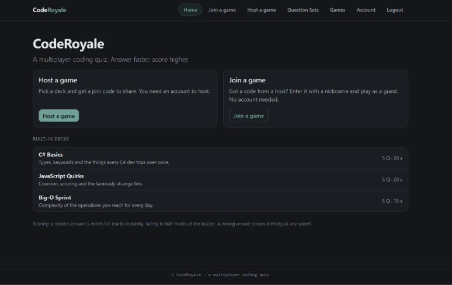

*(fig. 1) Home Screen while logged in*

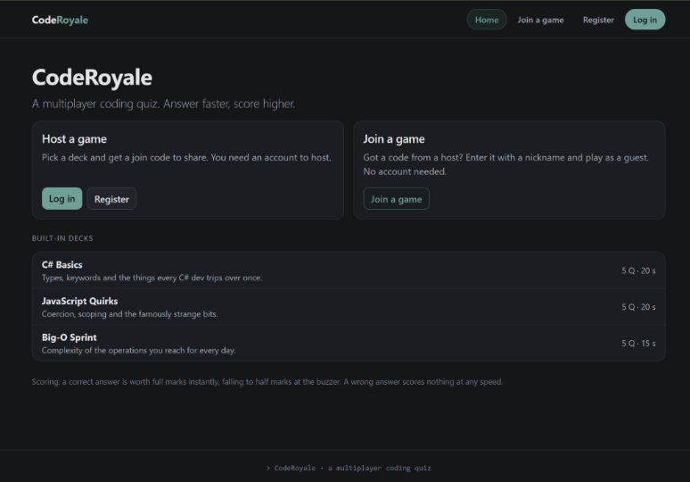

*(fig. 2) Home Screen while logged out*

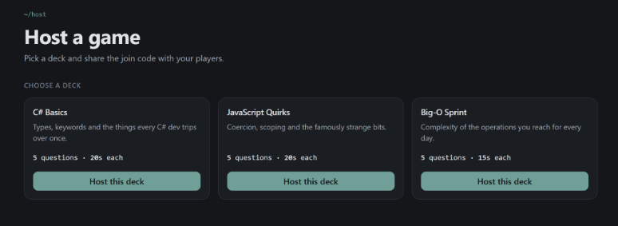

*(fig. 3) Host a game page*

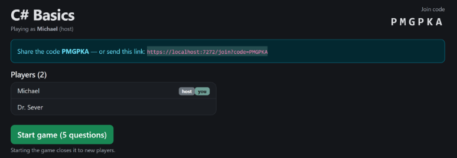

*(fig. 4) Game Lobby, waiting on players to join*

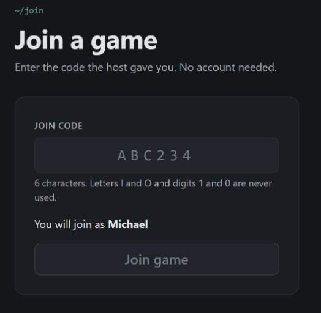

*(fig. 5) Join Screen*

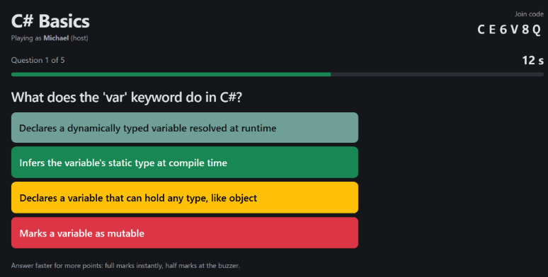

*(fig. 6) Multiple Choice Question choice screen*

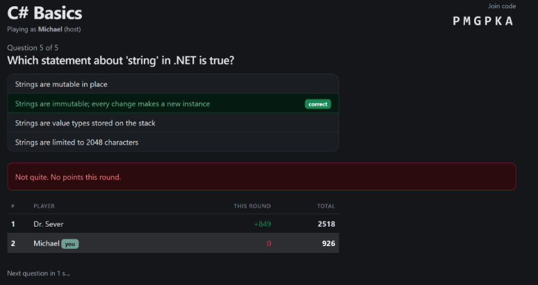

*(fig. 7) Multiple Choice Question results screen*

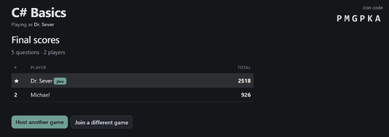

*(fig. 8) Game results screen*

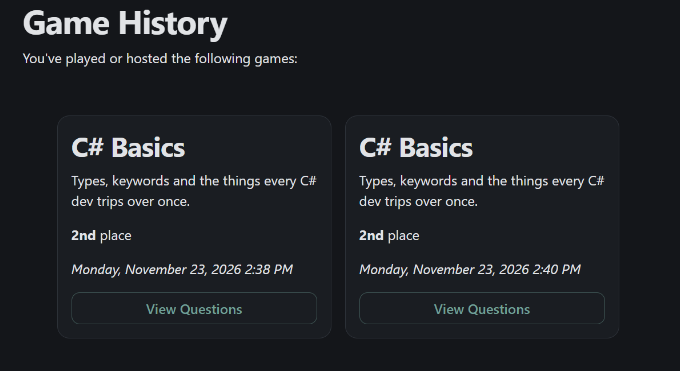

*(fig. 9) Game History page*

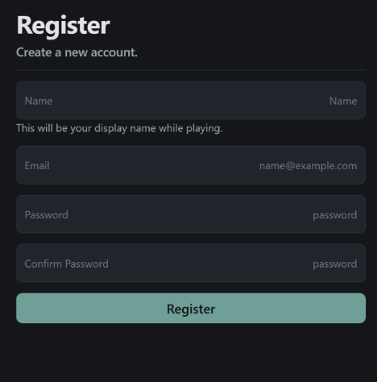

*(fig. 10) Register for a new account*

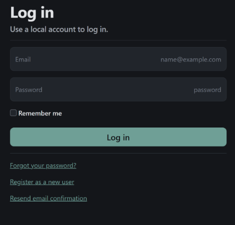

*(fig. 11) Log into an existing account*

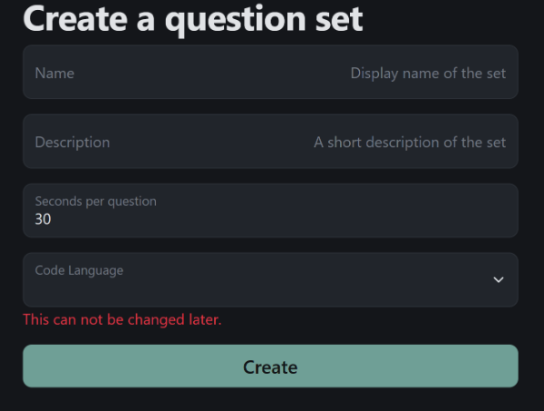

*(fig. 12) Create a new question set | Details Page*

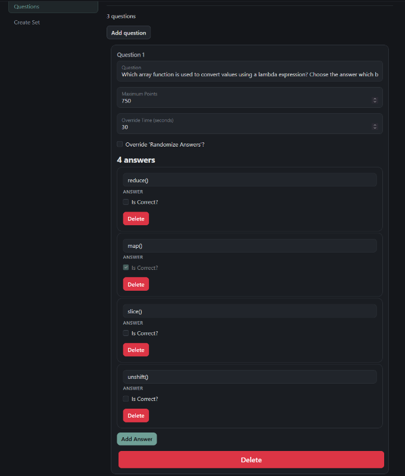

*(fig. 13) Create a new question set | Question List*

# Code Structure

## Application Stack

This application was created using the ASP.NET Blazor web framework, which is comparable to React but for C# instead of JS/TS. It uses the Blazor Server render mode, meaning that content is rendered on the server then sent to clients, and interactions are processed on the server. This communication is done using SignalR, a WebSocket-like protocol developed by the .NET team at Microsoft and used by Blazor. This allows interactions to happen extremely quickly and nearly eliminates loading time when switching pages.

The app stores its data in a MySQL database using EntityFramework Core for object mapping and query generation.

For our demo, we’re hosting it using [nginx](https://nginx.org/en/), which acts as a reverse proxy to avoid opening up the application to the internet directly. It accepts traffic on the HTTP and HTTPS ports and redirects it to the application’s local port. It also handles the SSL certificate to ensure our site works on modern browsers without security warnings. We got the SSL certificate for free from **LetsEncrypt**.

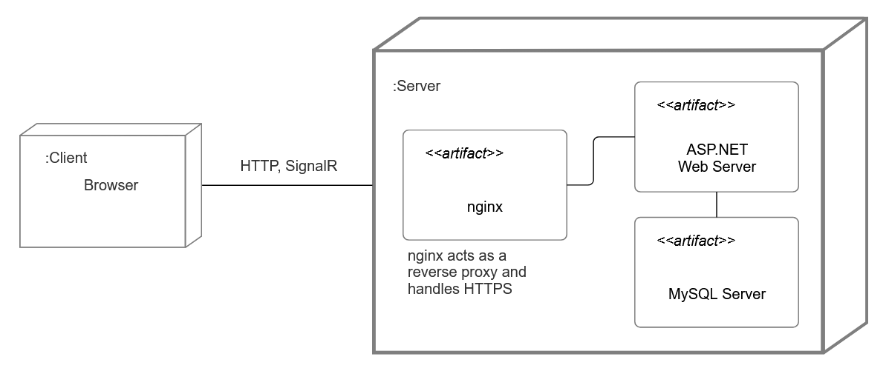

*(fig. 14) Deployment Diagram for the application*

## Evaluating Response Correctness
Our application has a complex feature which requires it to be able to execute user-submitted code in-process and evaluate its correctness. For this we used an existing library called [Jint](https://github.com/sebastienros/jint) (v5 beta). It allows you to simulate JavaScript code in-process quickly. During testing we found that simple user-submitted code could be fully evaluated in less than 200ms. Jint also has settings that make it safer to run user-submitted code in-process, such as limiting memory usage, overall statement execution counts, and an overall timeout. If a question takes too long to execute, it will be counted wrong and terminated. For example, while (true) { } could be submitted without any issues.

Another place where this is important is our use of regular expressions to evaluate correctness in Blank Entry and Code Entry Questions. We use timeouts and a non-backtracking RegEx engine to ensure that malicious patterns can’t be used to significantly slow the site down.

Language support is currently limited to JavaScript for Code Entry Questions. We did, however, design the app in a way that would make it simple to add more languages in the future. We use a factory to create an answer evaluator based on the language defined in the question set, which looks like this:

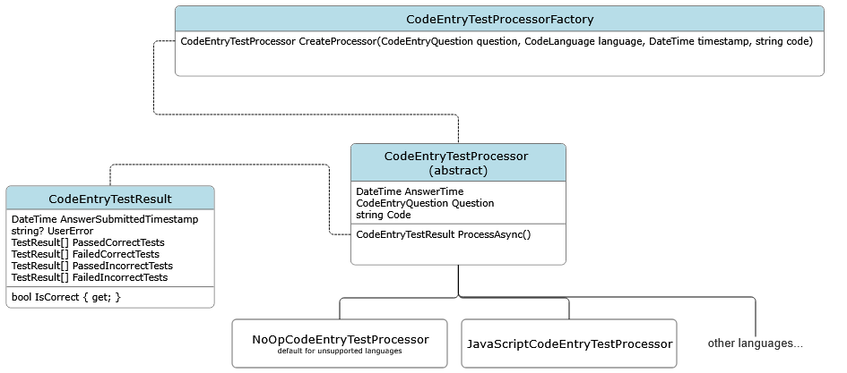

*(fig. 15) Class diagram modeling the CodeEntryTest evaluation system*

This evaluator (`CodeEntryTestProcessor`) returns a summary of the results, including any errors thrown by the user’s code and lists of which tests passed and failed. It also keeps track of the time the question was originally submitted so users don’t lose points due to code taking some time to grade.

## Database Models
Again, the application uses a database as its storage. The following diagram shows all the database models and their attributes, basic operations, inheritance, and dependencies.  

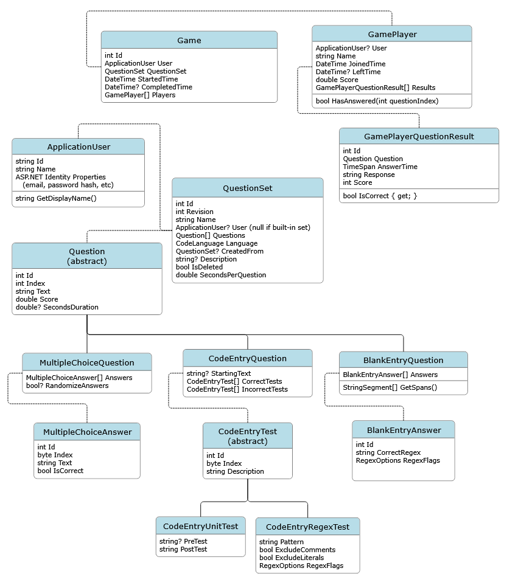

*(fig. 16) Domain class diagram modeling all entities*

## Web pages
Pages are created using `.razor` components, which mix C# and HTML into one file, and are converted to pure HTML by the server before sending to the client. Code for most game-related pages can be found under [CodeRoyale/Components/Pages](https://github.com/ITCS-6112-CodeRoyale/CodeRoyale/tree/dev/CodeRoyale/Components/Pages) in the repository, such as **[Play.razor](https://github.com/ITCS-6112-CodeRoyale/CodeRoyale/blob/dev/CodeRoyale/Components/Pages/Play.razor)** and **[Host.razor](https://github.com/ITCS-6112-CodeRoyale/CodeRoyale/blob/dev/CodeRoyale/Components/Pages/Host.razor)**.

# Disclosures

* Parts of this project’s codebase were developed with AI-assistance using Claude Code. No aspects of the documentation have been AI-assisted.
* The ASP.NET Identity template was used under the MIT license from the .NET Foundation (see below).
    ```
    The MIT License (MIT)

    Copyright (c) .NET Foundation and Contributors

    All rights reserved.

    Permission is hereby granted, free of charge, to any person obtaining a copy
    of this software and associated documentation files (the "Software"), to deal
    in the Software without restriction, including without limitation the rights
    to use, copy, modify, merge, publish, distribute, sublicense, and/or sell
    copies of the Software, and to permit persons to whom the Software is
    furnished to do so, subject to the following conditions:

    The above copyright notice and this permission notice shall be included in all
    copies or substantial portions of the Software.

    THE SOFTWARE IS PROVIDED "AS IS", WITHOUT WARRANTY OF ANY KIND, EXPRESS OR
    IMPLIED, INCLUDING BUT NOT LIMITED TO THE WARRANTIES OF MERCHANTABILITY,
    FITNESS FOR A PARTICULAR PURPOSE AND NONINFRINGEMENT. IN NO EVENT SHALL THE
    AUTHORS OR COPYRIGHT HOLDERS BE LIABLE FOR ANY CLAIM, DAMAGES OR OTHER
    LIABILITY, WHETHER IN AN ACTION OF CONTRACT, TORT OR OTHERWISE, ARISING FROM,
    OUT OF OR IN CONNECTION WITH THE SOFTWARE OR THE USE OR OTHER DEALINGS IN THE
    SOFTWARE.
    ```
* The following third-party tools, frameworks, and libraries were used:  
  * [C\#/.NET](https://dotnet.microsoft.com/en-us/languages/csharp) - Language/runtime  
  * [Visual Studio](https://visualstudio.microsoft.com/) - IDE  
  * [Aesprite](https://aseprite.org/) - Logo design  
  * [Photoshop](https://www.adobe.com/products/photoshop/landpa.html) - same  
  * [nginx](https://nginx.org/en/) - Reverse proxy  
  * [Let’s Encrypt](https://letsencrypt.org/) - SSL certificate  
  * [Certbot](https://certbot.eff.org/) - same  
  * [ASP.NET Blazor](https://learn.microsoft.com/en-us/aspnet/core/blazor/?view=aspnetcore-10.0) - Web framework  
  * [Jint](https://sebastienros.github.io/jint/) - JS simulation  
  * [Acornima](https://github.com/adams85/acornima) - JS parsing  
  * [Microsoft.EntityFrameworkCore](https://learn.microsoft.com/en-us/ef/core/) - Database ORM  
  * [Pomelo.EntityFrameworkCore.MySql](https://github.com/PomeloFoundation/Pomelo.EntityFrameworkCore.MySql) - same  
  * [MySqlConnector](https://mysqlconnector.net/) - Connects .NET to MySQL  
  * [HeidiSQL](https://www.heidisql.com/) - SQL viewer  
  * [Serilog](https://serilog.net/) - Logging  
  * [git](https://git-scm.com/) - Source control  
  * [GitHub](https://github.com/) - Source control hosting  
  * [Claude Code](https://claude.com/product/claude-code) - Development assistance